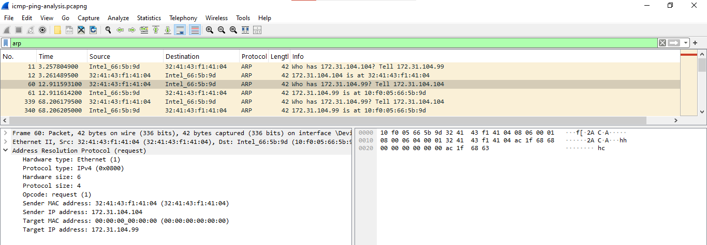
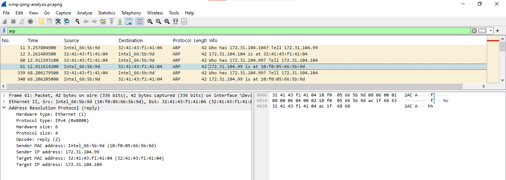

# Wireshark Network Traffic Analysis

## Project Overview

This project demonstrates practical network traffic analysis using Wireshark. It focuses on capturing and inspecting ICMP, ARP, and DNS packets to understand basic network communication.

## Objectives

- Capture and analyze ICMP Echo Request and Echo Reply packets.
- Examine ARP requests and replies to understand IPv4-to-MAC address resolution.
- Inspect DNS queries and responses to understand domain name resolution.
- Develop practical network troubleshooting and packet analysis skills.

## Tools Used

- Wireshark
- Windows Command Prompt
- `ping`
- `nslookup`

## Practical Activities

### 1. ICMP Analysis

Generated ping traffic and used the `icmp` display filter to inspect Echo Request and Echo Reply packets.

### 2. ARP Analysis

Used the `arp` display filter to examine ARP Request and ARP Reply packets and identify sender and target IP and MAC addresses.

### 3. DNS Analysis

Used `nslookup www.google.com` and the `dns` display filter to inspect DNS queries and responses.

## Key Skills Demonstrated

- Network packet capture and inspection
- Basic TCP/IP troubleshooting
- ICMP analysis
- ARP address resolution
- DNS query and response analysis
- Wireshark display filters

## Project Evidence

Screenshots and selected packet captures will be added to this repository where appropriate.

### ICMP Analysis

Filtered ICMP traffic with the `icmp` display filter. The capture shows Echo Request and Echo Reply pairs between 172.31.104.99 and 8.8.8.8.

**Echo Request** (Frame 582): Type 8, TTL 128, sequence number 5, answered in frame 583.

**Echo Reply** (Frame 583): Type 0, TTL 113, response time 71.430 ms.

### ARP Analysis

Filtered ARP traffic with the `arp` display filter to see how an IPv4 address is resolved to a MAC address.

**ARP Request** (Frame 60): Opcode 1. The sender asks "Who has 172.31.104.99?" and the target MAC is all zeros because it is not yet known.

**ARP Reply** (Frame 61): Opcode 2. The host 172.31.104.99 replies with its MAC address `10:f0:05:66:5b:9d`.

<!--
### DNS Analysis

Add the DNS screenshot here after uploading it:

-->

## Learning Outcome

This project improved my understanding of network protocols and practical troubleshooting techniques relevant to IT Support and Network Support roles.

## Author

Networking and Mobile Computing Undergraduate
